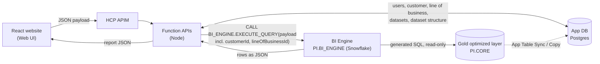

# BI Engine on Snowflake

How to build the BI Engine in Snowflake (database `PI`, schemas `CORE` and `BI_ENGINE`), replace the Postgres stored procedure, and connect the Node Function API to it.

Scripts are in [`snowflake/`](../snowflake/). Tests: `npx vitest run snowflake`.

> **Status.** The scripts and the procedure are written and unit-tested against a fake driver. The Snowflake query API is a separate Node project (see section 7). Sign-in and datasets stay in the App API (`server/`, Postgres). Run `snowflake/06_smoke_test.sql` before pointing the query API at the account.

## 1. What the architecture diagram says

The red outline covers the part of the diagram this work implements.



| Part | Role |
|---|---|
| **Gold layer** (`PI.CORE`) | All the reporting data, pre-aggregated and built by dbt. The engine only reads it. |
| **BI Engine** (`PI.BI_ENGINE`) | Turns the JSON payload into SQL, runs it on `CORE`, returns JSON. Holds the metadata (measures, attributes, relationships), the SQL cache and the logs. |
| **Query API** (separate Node project) | Authenticates to Snowflake and calls `EXECUTE_QUERY`. React supplies `customerId` / dataset from the App DB. |
| **App DB** (Postgres) | Owns `LINEOFBUSINESS`, `CUSTOMER`, `DATASET` and `DATASETSTRUCTURE`, plus users, sessions and the UI-facing metadata (measure and dataset lists). Fed in part by *App Table Sync* from Gold. **These four tables are not created in Snowflake.** |

The query API calls `PI.BI_ENGINE.EXECUTE_QUERY` in Snowflake over `PI.CORE`. The App API (`server/`) keeps a Postgres `bi_engine.execute_query` rollback for tests.

## 2. What is in the repo

| File | What it does |
|---|---|
| `snowflake/00_setup.sql` | Database `PI`, schemas `CORE` and `BI_ENGINE`, warehouse (no custom roles in the SYSADMIN-only setup) |
| `snowflake/01_core_gold.sql` | Dev-only `CORE.FACT_SAVINGS` (production Gold comes from dbt) |
| `snowflake/02_engine_tables.sql` | The 9 `BI_ENGINE` tables (engine metadata, caches, logs) from your screenshots |
| `snowflake/03_execute_query.sql` | `BI_ENGINE.EXECUTE_QUERY` (JavaScript stored procedure) |
| `snowflake/04_seed_savings_invoice.sql` | Metadata rows for the Savings Invoice report (template for new measures and filters) |
| `snowflake/05_grants.sql` | Access model |
| `snowflake/06_smoke_test.sql` | 11 checks to run in Snowsight |
| `snowflake/execute-query.test.js` | Unit tests that run the real procedure body against a fake driver |

## 3. Analysis of the schema screenshots

The 16 images in `schemas.zip` (plus the 7 attached in chat, which are copies of the same content) describe **13 tables**. Many images overlap or repeat. **Nine belong in Snowflake (`PI.BI_ENGINE`); four belong to the App DB (Postgres).**

### Tables created in Snowflake (`PI.BI_ENGINE`)

| Table (target schema `BI_ENGINE`) | Appears in | Notes |
|---|---|---|
| `MEASURE_DETAILS` (22 columns) | `MEASURE_DETAILS.png` | |
| `MEASURE_FILTER_DETAILS` (11) | `MEASURE_DETAILS.png` | |
| `ATTRIBUTE_DETAILS` (14) | `ATTRIBUTE_DETAILS.png` | |
| `RELATIONSHIP_METADATA_DETAILS` (16) | `ATTRIBUTE_DETAILS.png` | |
| `CROSSFACT_JOIN_KEY_POLICY` (8) | `EXECUTE_QUERY_CACHE.png`, `Screenshot ...093303` | Identical in both. File name is misleading: it shows two tables |
| `EXECUTE_QUERY_CACHE` (11) | `EXECUTE_QUERY_CACHE.png`, `Screenshot ...093303` | Identical in both |
| `CUSTOM_QUERY_CACHE` (13) | `CUSTOMER_QUERY_CACHE.png`, `Screenshot ...093303` | File says CUSTOMER, table is `CUSTOM_QUERY_CACHE` |
| `EXECUTE_QUERY_LOG` (12) | `QUERY_LOG.png` | |
| `EXECUTE_QUERY_ERROR_LOG` (10) | `QUERY_LOG.png` | |

### Tables that belong to the App DB (Postgres), not created in Snowflake

| Table | Appears in | Notes |
|---|---|---|
| `LINEOFBUSINESS` (14 columns) | `LINEOFBUSINESS.png`, `LINEOFBUSINESS(1).png` | Same table at two zoom levels |
| `CUSTOMER` (24) | `CUSTOMER.png` (full), `LINEOFBUSINESS*.png` (first 20 columns) | `CUSTOMER.png` is the complete list |
| `DATASET` | `DATASET.png`, `DATASET-01.png`, `Screenshot ...093203`, `Screenshot ...093736` | Four overlapping slices of one table |
| `DATASETSTRUCTURE` (14) | `DATASETSTRUCTURE.png`, `DATASETSTRUCTURE(1).png`, `Screenshot ...093203` | Identical in all three |

The screenshots show Snowflake syntax (`NUMBER(38,0)`, `TIMESTAMP_NTZ(9)`, `COLLATE 'en-ci'`) because they come from the legacy Snowflake `APP` schema, which the old V2 procedure read as `APP.DATASET`. In the target architecture they are App DB tables. The Snowflake scripts therefore do not create them, and the engine reads none of them. The Function API reads them from Postgres and passes only what the engine needs in the payload: `customerId`, `lineOfBusinessId` and, optionally, `datasetId` (used for the cache key and the log). Section 7 covers the Postgres side.

`BIEngine-Execute-Query.png` is not a table. It shows the first 33 lines of an older JavaScript procedure, `META.BI_EXECUTE_QUERY(PAYLOAD VARIANT, USE_CACHE BOOLEAN, SQL_ONLY BOOLEAN)`. The new procedure keeps its shape (`PAYLOAD`, `USE_CACHE`, `SQL_ONLY`, `RETURNS VARIANT`, same operator lists) and adds `USER_ID` and `CLIENT_IP`, which the V2 procedure and the log tables use.

### Things in the screenshots that need your attention

| # | Finding | What I did |
|---|---|---|
| 1 | The old JS procedure refers to `QUERY_CACHE` and `QUERY_ERROR_LOG`, but the table scripts and the V2 procedure use `EXECUTE_QUERY_CACHE` and `EXECUTE_QUERY_ERROR_LOG`. | Used the `EXECUTE_*` names. |
| 2 | `EXECUTE_QUERY_LOG.QUERY_HASH` is `VARCHAR`; in both caches it is `NUMBER(38,0)`. | Kept as shown. The procedure converts. |
| 3 | In `RELATIONSHIP_METADATA_DETAILS`, `CREATEDDATETIME` and `MODIFIEDDATETIME` are `VARCHAR`; every other table uses `TIMESTAMP_NTZ`. `CUSTOMATRJOININD` looks like a typo. | Kept as shown so production rows load unchanged. |
| 4 | The log and cache tables have no default on `EVENT_TS` / `CREATED_AT`; the V2 procedure inserts error-log rows without `EVENT_TS`. | Added `DEFAULT CURRENT_TIMESTAMP()` on those four columns. This is the only deviation in types or defaults. |

For whoever builds the Postgres versions of the four App DB tables:

- **`DATASET` may have hidden columns.** `DATASET-01.png` ends at `MHSA CARVE OUT INDICATOR`; `Screenshot 093203` starts at `CUSTOM_GROUP_RUN_DATE_TIME`. Nothing shows whether columns sit between them. Get the full column list (`DESCRIBE TABLE`) first.
- `MHSA CARVE OUT INDICATOR` is written with spaces in the screenshot; the real name is presumably `MHSA_CARVE_OUT_INDICATOR`.
- `LINEOFBUSINESS` uses `READ_POLICY_ID`; `CUSTOMER` and `DATASET` use `READPOLICY_ID`.
- `DATASET` and `CUSTOMER` hold dates as `TIMESTAMP_NTZ(9)` / `TIMESTAMP_TZ(9)`; use `timestamp` / `timestamptz` in Postgres.

Old-to-new naming: `AVRC_PRD_AVRC_DB.META.*` and `DBO.*` become `PI.BI_ENGINE.*`. `APP.*` moves to the App DB.

## 4. Build steps

Run in Snowsight or SnowSQL, in order. Scripts 00 and 01 need elevated roles; the rest run as `PI_BI_OWNER`.

| Step | Do this | Check |
|---|---|---|
| 1 | Run `00_setup.sql` as `ACCOUNTADMIN`. | `SHOW SCHEMAS IN DATABASE PI` lists `CORE` and `BI_ENGINE`. `SHOW ROLES LIKE 'PI_BI%'` lists three roles. |
| 2 | **Gold layer.** In production, point dbt at `PI.CORE`. For the POC, run `01_core_gold.sql` and load `public/data/savings-invoice.csv` using the `COPY INTO` in that file. | `SELECT COUNT(*) FROM PI.CORE.FACT_SAVINGS` returns 2,400. |
| 3 | `USE ROLE PI_BI_OWNER;` run `02_engine_tables.sql`. | 9 tables in `PI.BI_ENGINE`. |
| 4 | Run `03_execute_query.sql`. | `SHOW PROCEDURES LIKE 'EXECUTE_QUERY' IN SCHEMA PI.BI_ENGINE` returns one row. |
| 5 | **Metadata.** POC: run `04_seed_savings_invoice.sql`. Production: copy your existing rows, for example `INSERT INTO PI.BI_ENGINE.MEASURE_DETAILS SELECT * FROM AVRC_PRD_AVRC_DB.META.MEASURE_DETAILS WHERE ...`, for each of the five metadata tables. `LINEOFBUSINESS`, `CUSTOMER` and `DATASET` are not copied (App DB). Same account: `CREATE TABLE ... CLONE` also works. | `SELECT COUNT(*)` on each table. Then `TRUNCATE TABLE PI.BI_ENGINE.EXECUTE_QUERY_CACHE`. |
| 6 | Run `05_grants.sql`. | As `PI_BI_API`, `CALL` works and `SELECT * FROM PI.CORE.FACT_SAVINGS` is denied. |
| 7 | Run `06_smoke_test.sql` one statement at a time. | Each statement lists its expected result. |
| 8 | Create the Function API user with a key pair (template at the end of `00_setup.sql`). | Node can connect (step 9). |
| 9 | Set `SNOWFLAKE_*` in the query API project and start it (`npm start` on `:7072`). | Function API tab on Savings Invoice returns 24 months from Snowflake. |
| 10 | Production hardening: resource monitor on `PI_BI_WH`, network policy on the service user, `QUERY_TAG` per call, alert on rows in `EXECUTE_QUERY_ERROR_LOG`. | |

**When metadata changes** (a measure or attribute row is added or edited), run `TRUNCATE TABLE PI.BI_ENGINE.EXECUTE_QUERY_CACHE`. The cache holds generated SQL, not results, so data loads never make it stale.

## 5. How `EXECUTE_QUERY` works

```
CALL PI.BI_ENGINE.EXECUTE_QUERY(<payload>, <user id>, <client ip>, <use cache>, <sql only>)
```

1. **Parse and validate** the payload: types, limits, operator whitelist. Keys are case-insensitive and unknown keys such as `reportId` are ignored, so the React payload works unchanged.
2. **Scope.** `customerId` and `lineOfBusinessId` come from the payload. The engine does not look them up (those tables are in the App DB); the Function API has already read and authorised them.
3. **Cache.** The payload is normalised and hashed. A hit in `EXECUTE_QUERY_CACHE` returns the stored SQL and skips steps 4 and 5.
4. **Metadata.** Reads active rows (`TERMINATEDDATETIME IS NULL`) of `MEASURE_DETAILS` (this line of business, or any when `LINEOFBUSINESS_ID` is null), `MEASURE_FILTER_DETAILS`, `ATTRIBUTE_DETAILS` and `RELATIONSHIP_METADATA_DETAILS`.
5. **Build SQL.** One CTE per base measure, each with its own fact table, `CUSTOMER_ID` filter, request filters, optional month window, measure-level filters and `GROUP BY`. The CTEs are merged with `FULL OUTER JOIN ... EQUAL_NULL` on the group-by keys. Derived measures (`BASENUMERATOR` `OPERATOR` `BASEDENOMINATOR` `* RESULTMULTIPLIER`, up to 10 levels) are computed in the final `SELECT`. This is the same per-measure-then-merge design the V2 procedure uses.
6. **Run, cache, log.** Runs the SQL on `PI.CORE`, stores the SQL in the cache only after success, writes `EXECUTE_QUERY_LOG`. On failure writes `EXECUTE_QUERY_ERROR_LOG` (payload, error, failing SQL) and returns a generic message.

### Request

```json
{
  "customerId": 1,
  "lineOfBusinessId": 1,
  "datasetId": 1,
  "measures": ["claimsDenied", "grossSavings", "amount"],
  "aggregates": [{ "attributeKey": "month", "grain": "month" }],
  "filters": [
    { "attributeKey": "market", "values": ["AZ", "TX"] },
    { "attributeKey": "month", "operator": "BETWEEN", "values": ["2026-01", "2026-06"] }
  ],
  "months": 24,
  "attributeValues": ["market", "programType"],
  "recordLimit": 0,
  "recordStart": 0,
  "debug": false
}
```

| Field | Rules |
|---|---|
| `customerId` | Required. Set by the Function API from the session. Added as `F.CUSTOMER_ID = n` to every query. |
| `lineOfBusinessId` | Required. Read by the Function API from the App DB: the dataset's line of business when `datasetId` is used, otherwise the customer's. Selects which measures and attributes apply, and is part of the cache key. |
| `datasetId` | Optional. Already validated by the Function API against the App DB. The engine uses it only for the cache key and the log; it does **not** load the dataset's filters (the Function API sends them in `filters`, see section 8). |
| `measures` | Names from `MEASURE_DETAILS.MEASURE`, at most 25. Required unless `attributeValues` is sent. |
| `aggregates` | Group-by attributes, at most 5. `grain` is ignored. |
| `filters` | At most 25. Values within one filter are OR (`IN`); filters are ANDed. Operators: `= != <> > >= < <= IN, NOT IN, LIKE, NOT LIKE, BETWEEN, IS NULL, IS NOT NULL`. An empty `IN` list means all values. At most 200 values of 500 characters. |
| `months` | 1 to 60. The latest N months of the customer's data, using the attribute marked `ISYEARMONTH = 'Y'` for that fact (values must look like `2026-09`). |
| `attributeValues` | Returns up to 1,000 distinct values per attribute, for filter dropdowns. |
| `recordLimit`, `recordStart` | Paging. At most 10,000 rows are ever returned. |
| `debug` | Adds the generated SQL to the response. Do not forward this from the browser. |

### Response

```json
{
  "status": "OK",
  "dataset": { "id": 1 },
  "columns": [
    { "name": "month", "kind": "attribute", "description": "Month of Transaction" },
    { "name": "claimsDenied", "kind": "measure", "description": "Total # Claims Denied", "format": "#,##0" }
  ],
  "rows": [{ "month": "2026-09", "claimsDenied": 44 }],
  "rowCount": 24,
  "truncated": false,
  "appliedFilters": [{ "attributeKey": "market", "operator": "IN", "values": ["AZ", "TX"], "source": "request" }],
  "attributeValues": { "market": ["AK", "AL"], "programType": ["CPI", "EDC"] },
  "cache": { "hit": false, "hash": "-1234567890123456789" },
  "runtimeMs": 412
}
```

Errors are data, not exceptions: `{ "status": "ERROR", "code": "...", "message": "...", "field": "measures[0]" }`.

| `code` | Meaning | HTTP |
|---|---|---|
| `INVALID_REQUEST` | Bad payload, unknown measure or attribute | 400 |
| `NOT_FOUND` | Reserved. The Function API returns 404 itself for an unknown customer or dataset | 404 |
| `FORBIDDEN` | Reserved for access checks | 403 |
| `INVALID_METADATA` | A metadata row is unusable (bad SQL text, missing base measure) | 500 |
| `INTERNAL` | Query failed; details are in `EXECUTE_QUERY_ERROR_LOG` | 500 |

### How the metadata columns are used

I inferred these meanings from the column names and the V2 procedure. **Confirm them against a few production rows** (section 8, item 1).

| Table.column | Used as |
|---|---|
| `MEASURE_DETAILS.MEASURE` | The name in the payload and the output column |
| `.MEASUREFACT` | Fact table in `PI.CORE` (must be in `PI.CORE`; anything else is rejected) |
| `.SQLCALCSTATEMENT` | Aggregate over the fact alias `F`, e.g. `SUM(F.CLAIMS_DENIED)` |
| `.BASENUMERATOR` / `.BASEDENOMINATOR` / `.OPERATOR` / `.RESULTMULTIPLIER` / `.USESABSOLUTE` | Derived measure: `(num op den) * multiplier`; `/` divides by `NULLIF(den, 0)`; `USESABSOLUTE = 1` wraps in `ABS()` |
| `.FORMATSTRING`, `.MEASUREDESCRIPTION` | Returned in `columns` |
| `MEASURE_FILTER_DETAILS.FILTERSTATEMENT` | Added to that measure's WHERE. If it starts with an operator (`IN (...)`, `= ...`) and `ATTRIBUTEKEY` is set, the attribute's expression is put in front. `FILTERTYPE` is stored but not interpreted. |
| `ATTRIBUTE_DETAILS.ATTRIBUTEKEY` | The name in the payload. The row with the newest `MODIFIEDDATETIME` per key and line of business wins. |
| `.FILTERSQL` | Expression used when the relationship row has no `SQLCOLUMN` |
| `RELATIONSHIP_METADATA_DETAILS.FACTTABLE` + `.ATTRIBUTEKEY` | One row per attribute per fact: says the attribute can be used with that fact |
| `.SQLCOLUMN` | Column (bare names get the `F.` prefix) or expression |
| `.SQLJOINSTATEMENT` | Optional `JOIN` text added when the attribute lives in a dimension table |
| `.ISYEARMONTH` | `'Y'` marks the `YYYY-MM` attribute used for `months` |

Not used in this version: `CROSSFACT_JOIN_KEY_POLICY`, `CROSSFACTFILTER/GROUP`, `USESNORM`, `ISANNUALIZED`, `CC`, `SUPPORTNORM`, `CANONICAL_*`, `CUSTOM_QUERY_CACHE`. Measures on different fact tables still work (each gets its own CTE and they join on the group-by keys), but a join through a hash key as defined by that policy table is not implemented.

### Differences from the production V2 procedure

`BIEXECUTEQUERY_PARALLEL_V2` (your attachment) is the Custom-report orchestrator. It calls three procedures that were **not** attached, so it cannot be installed as is:

| Called by V2 | Needed for |
|---|---|
| `DBO.BIE_BUILD_PAYLOADS` | Splits the payload into per-measure payloads and hashes them |
| `DBO.BIEXECUTEQUERYASJSON` | Builds and caches the SQL for one measure |
| `DBO.BIE_BUILD_CUSTOM_MERGE_SQL` | Builds the merge, pivot and sort SQL |

`EXECUTE_QUERY` here is a self-contained procedure that covers what the Savings Invoice report needs (measures, group-by, filters, month window, paging, derived measures, caching, logging). It does **not** do custom measure definitions (`CustMeasureDef`), pivoting, `Operation` / `ApplyOperationToData`, `ReportType = Standard`, or parallel `ASYNC` per-measure builds. If you need those, send the three procedures (and `BI_EXECUTE_QUERY` in full) and I will port them: rename `AVRC_PRD_AVRC_DB.DBO.*` to `PI.BI_ENGINE.*`, `META.*` to `BI_ENGINE.*`. V2 reads `APP.DATASET` to find the line of business; that lookup has to move to the Function API (App DB), which then passes `lineOfBusinessId` in the payload. V2 is stored as a single-quoted string with doubled quotes and `\\\\`; if it is moved to `$$ ... $$` quoting, every `''` becomes `'` and `\\\\` becomes `\\`.

## 6. Security

- **Customer isolation.** `customerId` and `lineOfBusinessId` come from the Function API (signed-in user, App DB). The engine trusts them because only `PI_BI_API` can call it, so the Function API must never take either from the browser. `customerId` is added as `F.CUSTOMER_ID = n` to every CTE and to the dropdown query. Every fact table in `PI.CORE` must have a `CUSTOMER_ID` column.
- **No injection from the request.** Attribute keys, measure names and operators are matched against metadata or a whitelist and are never written to SQL as typed. Values are string literals with `\` and `'` escaped, control characters rejected, length and count capped. (Literals rather than bind variables because the generated SQL is cached and must be self-contained, as in V2.)
- **Metadata is trusted but screened.** `SQLCALCSTATEMENT`, `SQLCOLUMN`, `SQLJOINSTATEMENT`, `FILTERSTATEMENT` are developer-maintained SQL. The engine rejects `;`, comments and DDL/DML keywords in them, and requires fact tables to be in `PI.CORE`. Only `PI_BI_ADMIN` can edit them.
- **Least privilege.** The procedure runs as `PI_BI_OWNER`. The Function API role can only `CALL` it. The service user uses key-pair auth with no password.
- **Errors.** The caller never sees a Snowflake error message; details go to `EXECUTE_QUERY_ERROR_LOG`.
- `debug: true` returns SQL and table names. Only the Function API should set it, never pass it through from the browser.

## 7. Query API (separate project)

A separate Node service (Azure-ready) that only authenticates to Snowflake and calls `EXECUTE_QUERY`. It is not part of this reporting repo. React loads datasets and the signed-in customer from the App API (Postgres), builds the payload, and POSTs `/api/query` there.

`customerId` on the payload comes from the signed-in App DB user. `debug` from the browser is dropped. In production, APIM / One Healthcare ID should overwrite `customerId` and `lineOfBusinessId` from the token.

This reporting app only needs the query URL (`VITE_QUERY_API_BASE_URL`, default `/api` proxied to `:7072`). Start the query service independently.

## 8. Open points

1. **Metadata semantics are inferred** (table in section 5). Compare `04_seed_savings_invoice.sql` with a few real rows, especially `SQLCALCSTATEMENT` (is the fact alias `F` used?), `SQLCOLUMN`/`SQLJOINSTATEMENT`, `ISYEARMONTH` values and `FILTERTYPE` values.
2. **App DB tables.** `LINEOFBUSINESS`, `CUSTOMER`, `DATASET` and `DATASETSTRUCTURE` need Postgres versions. Today the app has only simplified `pi.customer` and `pi.dataset`, with no line of business. Get the full `DATASET` column list first (section 3).
3. **Where dataset filters live.** In the POC a dataset is a set of filter values stored in the App DB. The full `DATASET` table is a different shape (service, payment and enrollment periods; no filter values). The Function API therefore sends the filters in the payload and the engine uses `datasetId` only for the cache key and the log. If dataset filters live in another App DB table, tell me which.
4. **Ids must match across the two databases.** `CORE.*.CUSTOMER_ID` must equal the App DB `CUSTOMER_ID`, and `LINEOFBUSINESS_ID` in the Snowflake metadata tables must equal the App DB `LINEOFBUSINESS_ID`.
5. **Dataset visibility** (owner / public / status) is enforced by the Function API against the App DB. The engine performs no dataset check.
6. **Gold tables** must have `CUSTOMER_ID` and, for the month window, a `YYYY-MM` text column.
7. **Not verified in Snowflake.** The generated SQL uses only standard Snowflake features (CTEs, `FULL OUTER JOIN`, `EQUAL_NULL`, `NULLIF`, `DATEADD`, `TO_DATE`, `MERGE`, `HASH`), but run the smoke test before relying on it.

## 9. Operating it

```sql
-- recent calls and failures
SELECT EVENT_TS, USER_ID, MEASURE, CACHE_HIT, STATUS, RUNTIME_MS FROM PI.BI_ENGINE.EXECUTE_QUERY_LOG ORDER BY EVENT_TS DESC LIMIT 50;
SELECT EVENT_TS, ERROR_MESSAGE, ERROR_SQL, XML_QUERY FROM PI.BI_ENGINE.EXECUTE_QUERY_ERROR_LOG ORDER BY EVENT_TS DESC LIMIT 20;

-- cache effectiveness and slowest queries
SELECT MEASURE, USECOUNT, RUNTIME_MS, LASTUSE FROM PI.BI_ENGINE.EXECUTE_QUERY_CACHE ORDER BY RUNTIME_MS DESC LIMIT 20;

-- after changing metadata
TRUNCATE TABLE PI.BI_ENGINE.EXECUTE_QUERY_CACHE;
```

**Add a measure:** insert a row in `MEASURE_DETAILS` (and `MEASURE_FILTER_DETAILS` if needed), clear the cache. **Add a filter or group-by:** insert a row in `ATTRIBUTE_DETAILS` and one `RELATIONSHIP_METADATA_DETAILS` row per fact table, clear the cache. No procedure change.
