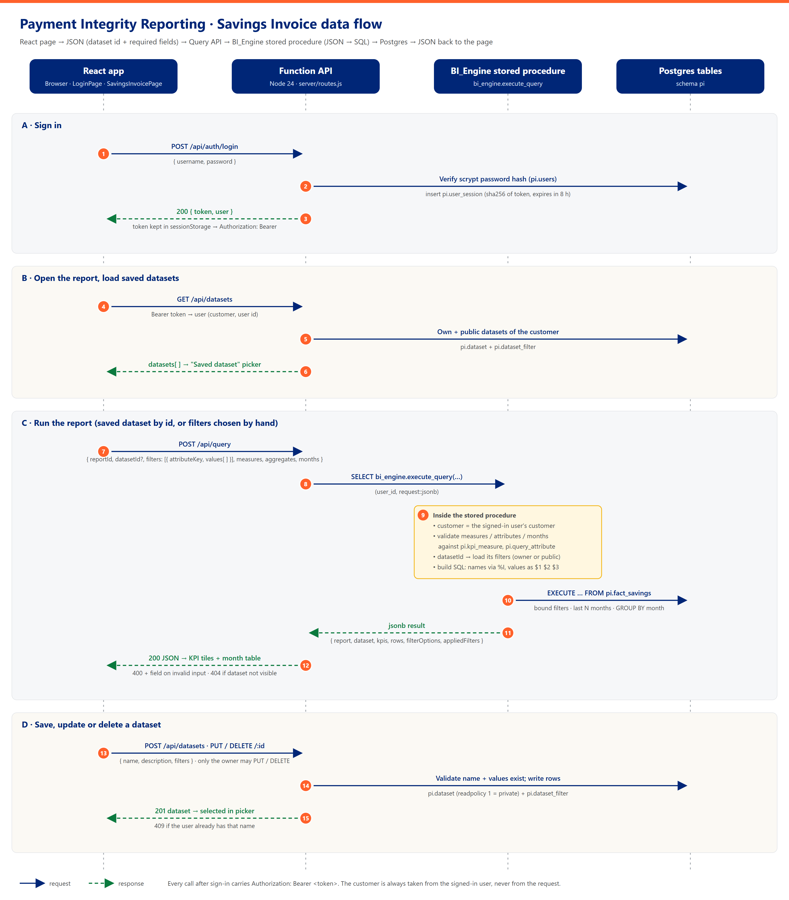

# Savings Invoice: workflow

How a user's request travels from the report page to the database and back, and how saved datasets fit in. This covers the local proof of concept: React, a Node Function API and Postgres 16.



The step numbers below match the numbers in the diagram. An editable vector copy of the diagram is in [flow-diagram.svg](flow-diagram.svg).

## 1. Summary

```
React page ─▶ JSON (dataset id + required fields) ─▶ Query API ─▶ BI_Engine stored procedure (JSON → SQL) ─▶ Postgres ─▶ JSON back
```

| Part | What it does | Where |
|---|---|---|
| React app | Sign-in screen, Savings Invoice report, dataset picker, multi-select filters, KPI tiles and month table | `src/` |
| Function API | Sign-in and sessions, dataset create/read/update/delete, and the Query API that passes the request to the stored procedure | `server/` |
| BI_Engine stored procedure | `bi_engine.execute_query(user_id, request jsonb)`: checks the JSON request, builds the SQL, runs it and returns JSON | `server/db/sql/02_bi_engine.sql` |
| Postgres tables | Users, sessions, report catalog, savings facts, datasets | `server/db/sql/01_schema.sql` |

A **dataset** is a named, saved set of filter values, for example *Arizona-CPI* = Market `AZ` + Program Type `CPI`. Users pick a dataset instead of setting each filter by hand. Each filter can hold several values, for example Market `AZ, NM, TX`.

## 2. Workflows

### A. Sign in (steps 1–3)

1. The user enters a username and password. The app sends `POST /api/auth/login`.
2. The API looks up the user in `pi.users` and checks the password against its scrypt hash. On success it creates a session row in `pi.user_session`. Only the SHA-256 of the token is stored, and the session lasts 8 hours.
3. The API returns `{ token, user }`. The app keeps the token in `sessionStorage` and sends it on every later call as `Authorization: Bearer <token>`.

- A wrong username and a wrong password both return the same message, *Invalid username or password*. This avoids revealing which usernames exist.
- Every page needs a signed-in user. A deep link such as `#/explore/savings-invoice` opens after sign-in.
- If any call returns 401 (session expired or revoked), the app goes back to the sign-in screen and shows *Your session expired*.
- **Sign out** (avatar menu) calls `POST /api/auth/logout`, which deletes the session row.

### B. Open the report and load saved datasets (steps 4–6)

4. On opening the report, the app calls `GET /api/datasets`.
5. The API finds the user from the token. It returns the user's own datasets first, then any **public** datasets of the same customer, each with its filters from `pi.dataset_filter`.
6. The app fills the **Saved dataset** picker, grouped into *My datasets* and *Public datasets*.

### C. Run the report (steps 7–12)

7. The app sends `POST /api/query`:

   ```json
   {
     "reportId": "savings-invoice",
     "datasetId": 1,
     "measures": ["claimsDenied", "grossSavings", "amount"],
     "aggregates": [{ "attributeKey": "month", "grain": "month" }],
     "filters": [{ "attributeKey": "market", "values": ["AZ", "TX"] }],
     "months": 24
   }
   ```

   What the app sends depends on the screen state:

   | Screen state | Request |
   |---|---|
   | No dataset selected | `filters` from the Market / Program Type selections |
   | Dataset selected, unchanged | `datasetId` only. The stored procedure loads the dataset's filters itself |
   | Dataset selected, then a filter changed ("Modified") | `filters` only, from the screen |

8. The API calls `SELECT bi_engine.execute_query(user_id, request::jsonb)`. The user ID comes from the session, never from the request body.
9. Inside the stored procedure:
   - **Customer scope:** the customer is read from the user's record. Every query is limited to that customer.
   - **Validation against the catalog:** each measure must exist in `pi.kpi_measure` and each filter or group attribute in `pi.query_attribute`. `months` must be 1–60, and each filter can have at most 200 values. Anything else stops the request with a message that names the field.
   - **Dataset:** if `datasetId` is present, the dataset must belong to the user, or be public within the same customer. Its filters are loaded and `last_accessed_date_time` is updated.
   - **SQL building:** table and column names come only from the catalog and are quoted with `%I`. Aggregate expressions come only from `pi.kpi_measure`. Values are never written into the SQL text: `$1` is the customer, `$2` the filter values as JSON, `$3` the first month.
10. The procedure runs one query for the monthly rows and one for the KPI totals, both against `pi.fact_savings`. It also reads the distinct filter values for the dropdowns.
11. It returns one JSON object: `{ report, dataset, kpis, rows, filterOptions, appliedFilters }`. Adding `"debug": true` to the request also returns the generated SQL and its parameters.
12. The API passes the JSON through. The app shows the KPI tiles and the month table, and the caption names the dataset, the filters and the source.

**Filter rules:**
- Several values in one filter mean OR (AZ or TX).
- Different filters are combined with AND (Market and Program Type).
- An empty filter means all values.
- A `datasetId` and extra `filters` sent together are also combined with AND.

### D. Save, update or delete a dataset (steps 13–15)

| User action | Call | Rules |
|---|---|---|
| **Save as dataset** (no dataset selected, filters chosen) | `POST /api/datasets { name, description, filters }` | Name is required (at most 100 characters) and must be unique for that user, ignoring case. Every value must exist in the data. |
| **Save as new** (dataset modified) | `POST /api/datasets` | As above. Creates a separate dataset. |
| **Update "name"** (dataset modified) | `PUT /api/datasets/:id { filters }` | Owner only. |
| **Rename** (pencil icon) | `PUT /api/datasets/:id { name, description }` | Owner only, same name rules. |
| **Delete** (bin icon, with a confirm step) | `DELETE /api/datasets/:id` | Owner only. The filters stay on screen. |

13. The app sends the call.
14. The API checks the name and filter values, then writes `pi.dataset` and its `pi.dataset_filter` rows in a single transaction. New datasets are private (`readpolicy_id = 1`).
15. The API returns the saved dataset, and the app selects it in the picker. A duplicate name returns 409, and the error appears under the name box.

## 3. Data model

| Table | Purpose |
|---|---|
| `pi.customer` | Customer (Centene) |
| `pi.users` | Username, display name, scrypt password hash, customer |
| `pi.user_session` | Hashed bearer tokens with expiry |
| `pi.report` | Report → fact table and month column |
| `pi.kpi_measure` | Measures the procedure may compute, e.g. `claimsDenied` = `sum(claims_denied)` |
| `pi.query_attribute` | Attributes that can be filtered or grouped: `month`, `market` → `market`, `programType` → `program_type` |
| `pi.fact_savings` | Monthly savings by customer, market and program type (2,400 synthetic rows) |
| `pi.dataset` | Simplified subset of the Snowflake `DATASET` table (same column names) |
| `pi.dataset_filter` | One row per selected value: `(dataset_id, attribute_key, value)` |

**Dataset visibility (`readpolicy_id`):**
- `1` = private: only the owner can see it.
- `2` = public: every user of the same customer can see it, read-only.

Listing, reading and querying already honour public datasets. The UI and API don't offer a way to make a dataset public yet; see section 6.

## 4. Errors

| Status | When | What the user sees |
|---|---|---|
| 400 | Unknown measure or attribute, bad `months`, a filter value that isn't in the data, missing name | Message, plus `field` naming the bad input |
| 401 | Not signed in, wrong password, session expired | Sign-in screen |
| 403 | Changing someone else's dataset | Error message |
| 404 | Dataset doesn't exist or isn't visible to this user | Error message |
| 409 | Duplicate dataset name for this user | Message under the name box |
| 500 | Unexpected server error (details are only logged on the server) | *Internal server error* |

Inside the stored procedure, errors are raised with SQLSTATE `22023` (invalid request), `P0002` (not found) or `42501` (not allowed). The API turns these into 400, 404 and 403.

## 5. Running it locally

```bash
npm install
npm run db:up       # Postgres 16 in Docker
npm run db:setup    # schema, stored procedure, catalog, users, synthetic data, example datasets
npm run api         # Function API on :7071
npm run dev         # React app on :5173 (proxies /api to :7071)
```

- **Demo users:** `analyst` has three example datasets (Arizona-CPI, Southwest-EDC, Big Four States). `reviewer` has one (Texas-All). Both use the password `Password123!`, or `SEED_PASSWORD` if set.
- **Resetting:** `npm run db:setup` rebuilds everything, so it deletes datasets users have saved.
- **Tests:** `npm test` runs the unit tests and the API / stored-procedure integration tests. The integration tests are skipped when Postgres isn't set up.

## 6. Next steps

- **Public datasets:** accept `isPublic` on `POST`/`PUT /api/datasets`, which sets `readpolicy_id = 2`, and add a toggle to the save dialog. Decide who may publish.
- **HPM shell:** the report becomes a remote in PI's repo. Sign-in, header and customer selection come from the shell. The loader calls `executeQuery` from `@avrc/ui`, which uses the same request shape.
- **Production BI_Engine:** replace `bi_engine.execute_query` with the real BI_Engine stored procedure (Snowflake), keeping the same request and response JSON. Map `pi.dataset` to the full Snowflake `DATASET` table.
- **More measures or filters:** add rows to `pi.kpi_measure` / `pi.query_attribute` (and the column to the fact table). No stored-procedure change is needed.
