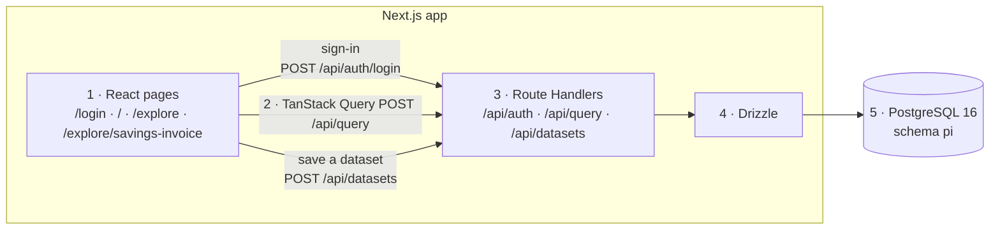

# Payment Integrity Reporting

Savings Invoice is a prepay savings report for one customer, Centene. This folder is one Next.js app. The pages and the Route Handlers run in the same process. The report page is a client component and loads its numbers with TanStack Query.

```text
Savings Invoice page
  -> TanStack Query POST /api/query
  -> Route Handler
  -> Drizzle
  -> pi.fact_savings
  -> JSON back to the query cache
```

Sign-in (`POST /api/auth/login`) and saving a dataset (`POST /api/datasets`) are the other two calls. The same diagram is in `docs/architecture.md`:



The on-screen month table can be downloaded as CSV. The fact rows are synthetic.

## Run it

Use Node 24 and Docker.

```bash
npm install
cp .env.example .env.local
npm run db:up
npm run db:migrate
npm run db:seed
npm run dev
```

On Windows, copy the env file with `copy .env.example .env.local`.

Open http://localhost:3000 and sign in as `analyst` or `reviewer`. The password is `Password123!` unless `SEED_PASSWORD` is set. `analyst` has Arizona-CPI, Southwest-EDC, and Big Four States. `reviewer` has Texas-All.

## Configuration

| Name | Example | What it does |
| --- | --- | --- |
| `DATABASE_URL` | `postgres://pi:pi@localhost:5432/pi` | Drizzle connection string. Docker Compose creates this database. |
| `SEED_PASSWORD` | `Password123!` | Password `npm run db:seed` stores for both demo users. When unset, the seed uses `Password123!`. |
| `SESSION_COOKIE` | `pi_session` | Name of the httpOnly session cookie. The database stores the SHA-256 of the token, not the token. |

## API

Errors are JSON `{ "error": "...", "field"?: "..." }`. Status 400 is invalid input, 401 is not signed in, 403 is not the owner, 404 is not found, 409 is a duplicate name, and 500 is `Internal server error`. The server logs the 500 cause and does not send it to the browser.

| Route | What it does |
| --- | --- |
| `POST /api/auth/login` | Checks the username and password. On success, sets the session cookie and returns `{ "user": { ... } }`. |
| `POST /api/auth/logout` | Deletes the session row and clears the cookie. |
| `GET /api/auth/me` | Returns the signed-in user, or 401. |
| `GET /api/health` | Returns `{ "ok": true }` when Postgres answers. |
| `GET /api/datasets` | Lists the user's own active datasets, then public datasets of the same customer. |
| `POST /api/datasets` | Creates a private dataset and its filter rows. Returns 201. |
| `GET /api/datasets/:id` | Returns one visible dataset. |
| `PUT /api/datasets/:id` | Updates name, description, or filters. Owner only. |
| `DELETE /api/datasets/:id` | Deletes a dataset. Owner only. Returns 204. |
| `POST /api/query` | Runs Savings Invoice. |

Query request:

```json
{
  "reportId": "savings-invoice",
  "datasetId": 1,
  "measures": ["claimsDenied", "grossSavings", "amount"],
  "aggregates": [{ "attributeKey": "month", "grain": "month" }],
  "filters": [{ "attributeKey": "market", "values": ["AZ", "TX"] }],
  "months": 24
}
```

`datasetId` and `filters` are optional. Measures default to all three. `months` defaults to 24.

Query response:

```json
{
  "report": { "id": "savings-invoice", "title": "Savings Invoice", "customer": "Centene", "asOf": "...", "from": "2024-10", "to": "2026-09" },
  "dataset": { "id": 1, "name": "Arizona-CPI" },
  "kpis": [{ "key": "claimsDenied", "label": "Total # Claims Denied", "format": "number", "value": 1083 }],
  "filterOptions": { "market": ["AK", "AL"], "programType": ["CPI", "EDC"] },
  "appliedFilters": [{ "attributeKey": "market", "values": ["AZ"], "source": "dataset" }],
  "rows": [{ "month": "2026-09", "claimsDenied": 44, "grossSavings": 63815.2, "amount": 34641.9 }]
}
```

`dataset` is null when the request did not use a dataset. `appliedFilters.source` is `dataset` or `request`.

## Query rules

The customer id always comes from the signed-in user. A customer id in the JSON body is ignored.

Several values in one filter are OR. Different filters are AND. A dataset's filters and the request filters are AND when both are sent. An empty value list adds no predicate.

The screen sends `datasetId` and omits `filters` while a saved dataset is selected and unchanged. After the user changes a filter, it sends `filters` and omits `datasetId`.

`months` must be an integer from 1 to 60. The window is the latest N months, ending at `max(month)` for that customer in `pi.fact_savings`. `month` is `YYYY-MM`.

`filterOptions` are the distinct market and program type values for the customer. They ignore the active filters. KPI tiles are the sums over the filtered month window.

Unknown report, measure, attribute, or grain returns 400 with a field path such as `filters[0].attributeKey`.

## Data model

All tables are in schema `pi`. `readpolicy_id` 1 is private to the owner. `readpolicy_id` 2 is public to every user of that customer. New datasets are private. There is no control yet that sets a dataset public.

| Table | What it stores |
| --- | --- |
| `customer` | `customer_id`, `name` (unique). Seed customer 1 is Centene. |
| `users` | `user_id`, `username`, `display_name`, `password_hash`, `customer_id`, `is_active`. Unique on `lower(username)`. |
| `user_session` | `token_hash` (primary key, SHA-256 of the cookie), `user_id`, `created_date_time`, `expires_date_time`. A session lasts 8 hours. |
| `fact_savings` | One synthetic row per customer, month, market, and program type. Amounts are `numeric(14,2)`. Indexed by `(customer_id, month)` and `(customer_id, market, program_type)`. |
| `dataset` | Named filter set. Unique on `(customer_id, owner_user_id, lower(name))` while `dataset_status_id` is 1. |
| `dataset_filter` | One row per selected value. Primary key is `(dataset_id, attribute_key, value)`. |

## Project layout

| Path | What it is |
| --- | --- |
| `app/page.tsx` | Home. |
| `app/login/page.tsx` | Sign-in form. |
| `app/explore/page.tsx` | Report catalogue. One report, Savings Invoice, under Financial Dashboards. |
| `app/explore/savings-invoice/page.tsx` | Client report page. `useQuery` for the report and the dataset list, `useMutation` for create, update, and delete. |
| `app/api/**/route.ts` | Route Handlers. They call services and do not contain SQL. |
| `src/server/db/schema.ts` | Drizzle tables for the six `pi` tables. |
| `src/server/db/client.ts` | The one Drizzle client, opened from `DATABASE_URL`. |
| `src/server/auth.ts` | scrypt password check, SHA-256 session token, cookie set and clear, `requireUser()`. |
| `src/server/datasets.ts` | List, get, create, update, and delete, including the name rules and the create transaction. |
| `src/server/savings-invoice.ts` | The only report query. Fixed columns, Drizzle predicates, and the allowlist checks. |
| `src/server/http.ts` | `{ error, field? }` and the status codes above. |
| `middleware.ts` | Sends a user with no session cookie to `/login` and keeps the return path. |
| `docker-compose.yml` | Postgres 16, user `pi`, database `pi`, volume `pi-pgdata`. |
| `.env.example` | `DATABASE_URL`, `SEED_PASSWORD`, and `SESSION_COOKIE`. |
| `drizzle/0001_init.sql` | Creates schema `pi` and the six tables. `npm run db:migrate` applies it. |
| `scripts/seed.ts` | Loads Centene, both users, four datasets, and 2,400 synthetic fact rows. |
| `scripts/upgrade-from-poc.sql` | Manual script for an older database. Not run by `db:migrate`. |
| `src/model.ts` | Report, measure, and filter names shared by the page and the server. |

## Tests and reset

`npm test` checks password verification without a database. The rest of the tests need `DATABASE_URL` and the seed data. If `DATABASE_URL` is unset, or Postgres cannot be reached, those tests are skipped and the reason is printed.

`npm run db:migrate` applies new SQL files. It does not drop schema `pi` and it does not delete rows that are already there.

`npm run db:seed` inserts Centene, `analyst`, `reviewer`, the four datasets, and the synthetic fact rows. Running it again stops with an error so it does not insert a second customer. Set `SEED_RESET=1` to delete the child rows and load them again. The figures are synthetic and come from a fixed random seed.
