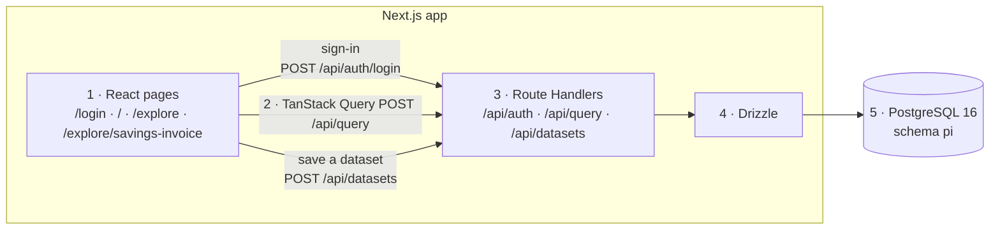

# Savings Invoice workflow

The step numbers below match the flowchart. Step 1 is the React page, step 2 is the TanStack Query call, step 3 is the Route Handler, step 4 is Drizzle, and step 5 is PostgreSQL schema `pi`.



## 1. Summary

| Step | Piece | What it does |
| --- | --- | --- |
| 1 | React page | `/login`, Home, Explore, and `/explore/savings-invoice`. Savings Invoice is a client component. |
| 2 | TanStack Query | `useQuery` posts the report and loads the dataset list. `useMutation` creates, updates, and deletes a dataset. |
| 3 | Route Handlers | `/api/auth/*`, `POST /api/query`, and `/api/datasets`. Handlers call services. They do not contain SQL. |
| 4 | Drizzle query module | `src/server/savings-invoice.ts` reads `pi.fact_savings` with a fixed column list. `src/server/datasets.ts` writes datasets. |
| 5 | Postgres tables | Schema `pi`: `customer`, `users`, `user_session`, `fact_savings`, `dataset`, `dataset_filter`. |

A dataset is a named set of filter values. Arizona-CPI means Market `AZ` and Program Type `CPI`. A filter can hold several values, for example Market `AZ`, `NM`, and `TX`.

## 2. Workflow A, Sign in

1. The user opens a page. `middleware.ts` looks for the session cookie. If it is missing, the browser goes to `/login` and the original path is kept as `next`.
2. The login page posts the username and password to `POST /api/auth/login`.
3. The server checks the scrypt hash stored as `<salt hex>:<hash hex>` on `pi.users`. An unknown username and a wrong password both return 401 `Invalid username or password`.
4. On success the server inserts `pi.user_session`. The primary key is the SHA-256 hex of the token. The cookie value is the raw token. The cookie is httpOnly and SameSite=Lax. The row expires in 8 hours.
5. The browser opens the return path, so a deep link still lands on the report after sign-in.
6. A later 401 clears the cookie and the page shows `Your session expired` on the sign-in screen.
7. Sign out calls `POST /api/auth/logout`, which deletes the session row and clears the cookie.

Every fact and dataset query uses the customer id on the session user. The request body cannot choose a customer.

## 3. Workflow B, Open the report and load datasets

The Savings Invoice page calls `useQuery` for `GET /api/datasets`. The list is the signed-in user's own active datasets first, then public datasets (`readpolicy_id` 2) of the same customer. Public datasets are read-only. For `analyst` the list is Arizona-CPI, Southwest-EDC, and Big Four States. For `reviewer` it is Texas-All.

The picker groups them into My datasets and Public datasets.

## 4. Workflow C, Run the report

The page builds this JSON. `months` defaults to 24 when it is omitted. Measures default to the three tiles.

```json
{
  "reportId": "savings-invoice",
  "datasetId": 1,
  "measures": ["claimsDenied", "grossSavings", "amount"],
  "aggregates": [{ "attributeKey": "month", "grain": "month" }],
  "filters": [{ "attributeKey": "market", "values": ["AZ", "TX"] }],
  "months": 24
}
```

The query key is the dataset id, or the filter lists, so the cache follows the screen rule.

| Screen state | What the page sends |
| --- | --- |
| No dataset | `filters` when any are selected. `datasetId` is omitted. An empty selection sends neither. |
| Unchanged dataset | `datasetId` only. `filters` are omitted. |
| Modified dataset | `filters` only. `datasetId` is omitted. |

Server steps:

1. The handler reads the session cookie and takes the customer from that user.
2. `savings-invoice.ts` checks the allowlists. Unknown report, measure, attribute, or grain is 400 with a field path such as `filters[0].attributeKey`. `months` must be an integer from 1 to 60. Aggregates accept only month/month.
3. If `datasetId` is set, the dataset must be active, belong to the same customer, and be owned by the user or public. Otherwise the response is 404. The handler sets `last_accessed_date_time`.
4. Drizzle reads `pi.fact_savings` for that customer. The month window starts at `max(month)` and keeps the latest N months. `month` is `char(7)` in `YYYY-MM` form. Each measure is `round(sum(column), 2)`: `claims_denied`, `gross_savings`, and `amount`. Rows come back newest first.
5. KPI sums use the same filtered window, not the unfiltered table.
6. A second query loads distinct `market` and `program_type` values for the customer only. Those `filterOptions` ignore the active filters.
7. The JSON goes back to the TanStack Query cache. The page renders the three KPI tiles and the sortable month table. The caption names the dataset, whether it is modified, and the active filters. Export writes the rows on screen to `savings-invoice.csv`.

Filter rules: several values in one filter are OR. Different filters are AND. A dataset's filters and request filters are AND when a caller sends both. An empty value list adds no predicate.

Response shape:

```json
{
  "report": { "id": "savings-invoice", "title": "Savings Invoice", "customer": "Centene", "asOf": "...", "from": "2024-10", "to": "2026-09" },
  "dataset": { "id": 1, "name": "Arizona-CPI" },
  "kpis": [{ "key": "claimsDenied", "label": "Total # Claims Denied", "format": "number", "value": 1083 }],
  "filterOptions": { "market": ["AK", "AL"], "programType": ["CPI", "EDC"] },
  "appliedFilters": [{ "attributeKey": "market", "values": ["AZ"], "source": "dataset" }],
  "rows": [{ "month": "2026-09", "claimsDenied": 44, "grossSavings": 63815.2, "amount": 34641.9 }]
}
```

`dataset` is null when no dataset was used. `appliedFilters.source` is `dataset` or `request`. The figures are synthetic.

## 5. Workflow D, Save, update, delete

| Action | What the page does |
| --- | --- |
| Save as dataset | No dataset is selected and at least one filter value is set. `POST /api/datasets` with the current filters. |
| Save as new | A dataset is selected and the filters were changed. `POST /api/datasets` with the current filters and `copiedFromId`. |
| Update filters | The owner clicks Update. `PUT /api/datasets/:id` with the current filters. |
| Rename | The owner edits the name and description. `PUT /api/datasets/:id` without replacing filters. |
| Delete | The owner confirms. `DELETE /api/datasets/:id`. The filters stay on screen. |

Name is required, trimmed, and at most 100 characters. It is unique per owner, ignoring case. Description is optional and at most 1,000 characters. Filters use `market` or `programType`. At least one value is required overall. Each attribute allows at most 200 values. Values are non-empty strings and must exist on that customer's fact rows.

Create writes `pi.dataset` and `pi.dataset_filter` in one transaction. One `dataset_filter` row is stored per selected value. The new dataset is private (`readpolicy_id` 1). A duplicate name returns 409 with field `name`, and the dialog shows that message under the name box. Update and delete are owner-only (403). A missing or invisible dataset is 404.

## 6. Data model

| Table | Columns that matter here |
| --- | --- |
| `pi.customer` | `customer_id`, `name` unique. Seed row 1 is Centene. |
| `pi.users` | `user_id` identity, `username`, `display_name`, `password_hash`, `customer_id`, `is_active`. Unique index on `lower(username)`. |
| `pi.user_session` | `token_hash` primary key, `user_id`, `created_date_time`, `expires_date_time`. |
| `pi.fact_savings` | `customer_id`, `month` char(7), `market`, `program_type`, `claims_denied`, `gross_savings`, `amount`. Indexes `(customer_id, month)` and `(customer_id, market, program_type)`. |
| `pi.dataset` | `dataset_id` identity, customer, name, description, `dataset_status_id` default 1, `copied_from_dataset_id`, `owner_user_id`, `readpolicy_id` default 1, created and modified user and timestamps, `last_accessed_date_time`. Unique `(customer_id, owner_user_id, lower(name))` where status is 1. |
| `pi.dataset_filter` | `dataset_id`, `attribute_key`, `value`. Those three columns are the primary key. |

`readpolicy_id` 1 is private. `readpolicy_id` 2 is visible to every user of the same customer, and those users still cannot update or delete it.

## 7. Errors

| Status | When | What the user sees |
| --- | --- | --- |
| 400 | Invalid JSON, an unknown report, measure, attribute, or grain, `months` outside 1–60, a blank name, or a filter value that is not in the fact rows. | The `error` text. A field path is returned when it applies. |
| 401 | Sign-in failed, or a later call has no live session. | Sign-in shows `Invalid username or password`. A later 401 clears the cookie and shows `Your session expired`. |
| 403 | Update or delete of a dataset the user can see but does not own. | `Only the owner can change this dataset` or `Only the owner can delete this dataset`. |
| 404 | Dataset id is missing, inactive, or not visible to this user. | `Dataset … not found`. |
| 409 | The owner already has an active dataset with that name, ignoring case. | The message under the name box. `field` is `name`. |
| 500 | Anything else. | `Internal server error`. The cause is logged on the server only. |

## 8. Running it locally

```bash
npm install
cp .env.example .env.local
npm run db:up
npm run db:migrate
npm run db:seed
npm run dev
```

Node 24 and Docker are required. Sign in as `analyst` or `reviewer` with `Password123!`, or with `SEED_PASSWORD` if that variable is set.

## 9. Next steps

- Add a way to mark a dataset public. Reads already honor `readpolicy_id` 2.
- Add another report as another query module plus a catalogue entry on the Explore page.
