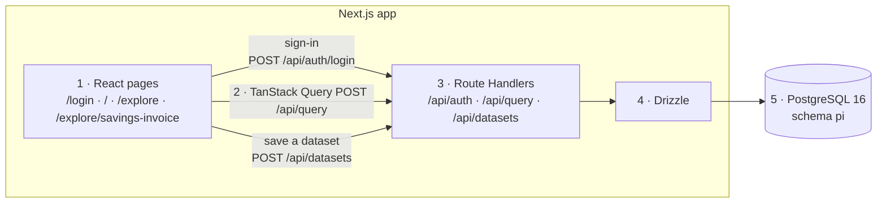
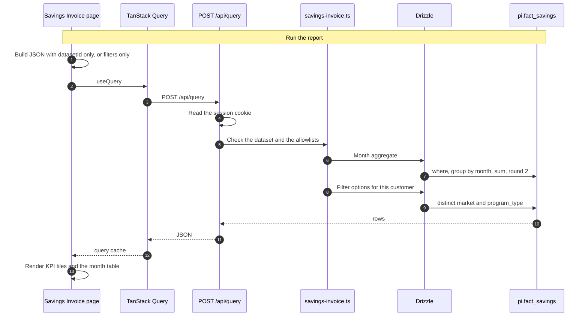
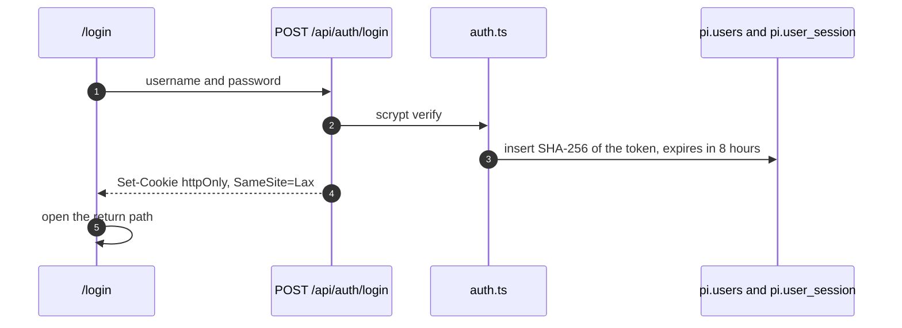
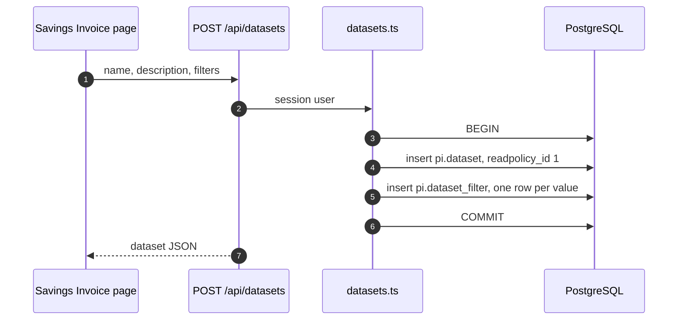

# Payment Integrity Reporting architecture

One Next.js process serves the React pages and the Route Handlers. The Savings Invoice page is a client component. It loads the report with TanStack Query v5, which posts JSON to the same origin. The Route Handler reads the session cookie, then a Drizzle query module reads PostgreSQL 16 schema `pi`. The JSON response goes back into the TanStack Query cache. There is no second API process.

## Request flow

The numbered steps are the ones the workflow doc refers to. Sign-in, the Savings Invoice report, and saving a dataset are the three calls. Drizzle sits in the Next.js process, between the Route Handler and PostgreSQL.

## Run the report

While a saved dataset is selected and its filters are unchanged, the page sends `datasetId` and omits `filters`. After the user changes a filter, the page sends `filters` and omits `datasetId`. `customer_id` always comes from the session user. Measures and attribute names are a TypeScript allowlist. The handler does not turn the JSON into SQL text.

## Sign in

Unknown username and wrong password both return 401 `Invalid username or password`. A later 401 clears the cookie. Logout deletes the `pi.user_session` row and clears the cookie.

## Create a dataset

A dataset is a named set of filter values for the session user's customer. Public datasets (`readpolicy_id` 2) are read-only. Update and delete are owner-only.

## Request fields

| Request field | Where it goes |
| --- | --- |
| `reportId` | TypeScript allowlist. The only value is `savings-invoice`. It is not a SQL predicate. |
| `datasetId` | Load `pi.dataset` for the session customer, active, owned by the user or `readpolicy_id` 2. Its `pi.dataset_filter` rows become `inArray` predicates. The handler sets `last_accessed_date_time`. |
| `measures` | TypeScript allowlist. `claimsDenied` sums `claims_denied`, `grossSavings` sums `gross_savings`, `amount` sums `amount`. Each value is `round(sum(column), 2)`. |
| `aggregates` | TypeScript allowlist. The only pair is `month` / `month`, which is `groupBy` on `pi.fact_savings.month`. |
| `filters[].attributeKey` | TypeScript allowlist. `market` is column `market`. `programType` is column `program_type`. |
| `filters[].values` | `inArray` on that column. Several values in one filter are OR. Different filters are AND. An empty list adds no predicate. |
| `months` | Integer 1–60, default 24. `gte` / `lte` on `month` for the latest N months, starting at `max(month)` for the session customer. `month` is `char(7)` `YYYY-MM`. |
| customer | Not accepted from the body. Every fact and dataset predicate uses `eq(customer_id, session user customer id)`. |

Dataset filters and request filters are AND when both are present. `filterOptions` are a separate query: distinct `market` and `program_type` for the session customer, with no filter predicates. KPI sums use the same filtered month window as the rows.

## Removed from this path

The previous path called `bi_engine.execute_query`, which compiled request JSON into SQL inside Postgres. This app queries `pi.fact_savings` with Drizzle instead. Schema `pi` has no `report`, `kpi_measure`, or `query_attribute` tables. There is no stored procedure and no second server.
